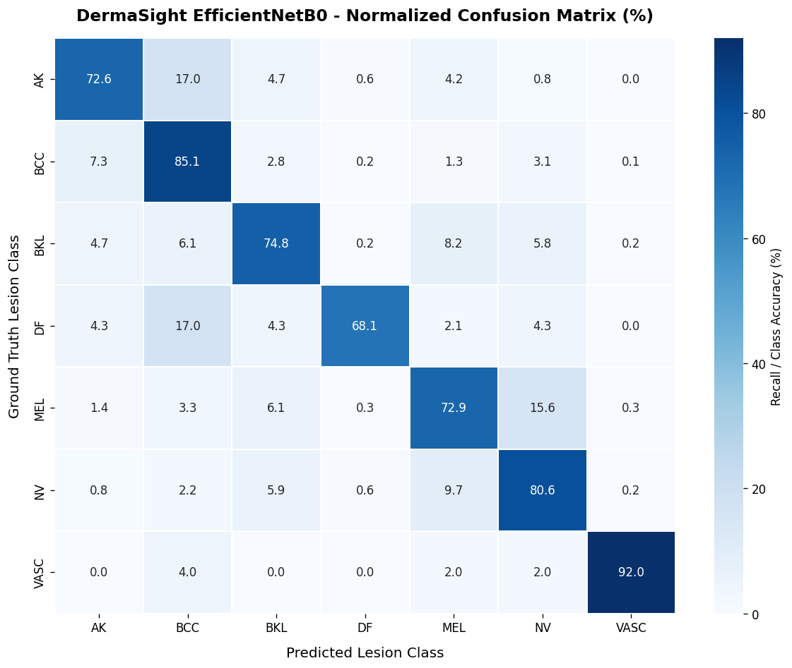

# Supplied notebook and model comparison — October 30, 2026

## Conclusion

The supplied `/Users/emman/Downloads/dermasight_model-2.tflite` is **byte-for-byte identical** to the EfficientNet model already selected by DermaSight. A model replacement or application rewrite is not required for these files. No app behavior, weights, labels, input scaling or thresholds were changed in this comparison.

The notebook was read as JSON/code and saved outputs. It was not executed; its package installs, downloads, training and filesystem operations were not run. Saved notebook metrics have not been independently reproduced.

## Binary identity

- File length: **8,957,408 bytes** (8.54 MiB).
- SHA-256: `ba541d0b9ce68007c2a58cefc217cda4c47db43fea147bf14d13a44c62c478c2`.
- Supplied model matches the root model, `src/assets/models/efficientnet_ham10000.tflite`, the Android assets copy and the Android raw resource.
- Latest built iPhone `.app` classifier also matches.
- Latest Android Debug APK contains two matching classifier copies (asset and raw fallback).

## Notebook specification versus app

| Item | Notebook | App | Finding |
|---|---|---|---|
| Architecture | EfficientNetB0 backbone, 256-unit dense head, 7-way softmax | Same supplied binary | Matches |
| Input size | 224×224 RGB | 224×224 RGB | Matches |
| Input range | Directory-loader pixel values passed through EfficientNet preprocessing | Raw 0–255 float32 input; model contains rescaling/normalization | Consistent |
| Output labels | `AK, BCC, BKL, DF, MEL, NV, VASC` | Same order in shared configuration and label files | Matches |
| Export | `DermaSight_Mobile`, optimized TFLite with Select TensorFlow ops | Same model, Select Ops support linked in the iPhone build | Consistent |
| U-Net in training/export | Not part of the notebook model | U-Net cropping currently disabled in capture/gallery | No U-Net is needed to execute this classifier |

The high-level input contract matches. TensorFlow versus the app's custom image-decoding/resize implementation has not been numerically compared on identical source images. Exact Keras-versus-TFLite prediction parity was not demonstrated in the saved notebook: the evaluation cell runs `model.predict`, before TFLite conversion. These are validation items, not evidence requiring an app rewrite.

## Correct interpretation of the recorded metrics

Notebook cell indexes below are zero-based.

| Metric | Saved notebook result | Meaning |
|---|---|---|
| Final training accuracy, phase 2 epoch 14 | **94.90%** | Training-set metric; not unseen-data accuracy |
| Best validation accuracy, phase 2 epoch 12 | **78.84%** | Best saved validation accuracy; evaluation cell also reports 0.7884 |
| Final epoch validation accuracy | **78.72%** | Epoch 14; weights then restored to best epoch 12 |
| Best validation AUC | **96.58%** | AUC, not classification accuracy |
| Validation samples | **5,396** | Same validation set used during model selection |

There is **no saved 90% validation accuracy result** in this notebook. The earlier 90% figure was a teammate-reported value, not an independently checked result. For this notebook, present 78.84% as the recorded best validation accuracy, and identify the evaluation setup. Do not describe the cell title “clinical performance” as proof of clinical validation. There is no separate held-out TFLite or prospective phone-use evaluation shown.

## Training data: correction to the earlier HAM10000-only description

The notebook merges ISIC 2019, PAD-UFES smartphone images and HAM10000 into seven target classes. The saved merge output reports:

- ISIC 2019: 24,703 images.
- PAD-UFES: 2,106 images.
- Additional HAM10000 images: 197 after the filename-based duplicate check.
- Raw merged total: 27,006 images.
- Balanced training: 2,500 examples per class, 17,500 total, including replicated minority examples.
- Validation: 5,396 images, with unequal class counts.

Thus this training is not exclusively dermoscopic: PAD-UFES contributes smartphone images. This does not establish performance for every phone, framing, skin tone or real-world case. Splitting is performed at file level; the notebook does not demonstrate patient/lesion-group isolation or a content-level cross-dataset duplicate audit. Leakage cannot be determined without the underlying data and identifiers.

## Existing class confusions

The saved validation report gives NV recall of **80.59%** and MEL recall of **72.87%**. The embedded normalized confusion matrix shows approximately:

- **9.7% of true NV validation images predicted as MEL**.
- **15.6% of true MEL validation images predicted as NV**.

These are model evaluation errors, not evidence that the application has swapped the two labels. They do not establish the true diagnosis of any user photograph. The report does not show the confidence distribution of these errors, so it cannot establish why a particular scan received 90.8% confidence.

The training loss also uses label smoothing of 0.05; per-image confidence must not be equated with dataset accuracy. Keep original model probabilities instead of forcing a higher score.

## Recommendation

Keep the identical model and verified class mapping. Use the recorded notebook metrics accurately in the presentation. If further investigation is needed, compare Keras and exported TFLite predictions on the exact same labelled validation images, with identical preprocessing, before changing any production input processing. No retraining, dependency installation or app rewrite was performed here.
